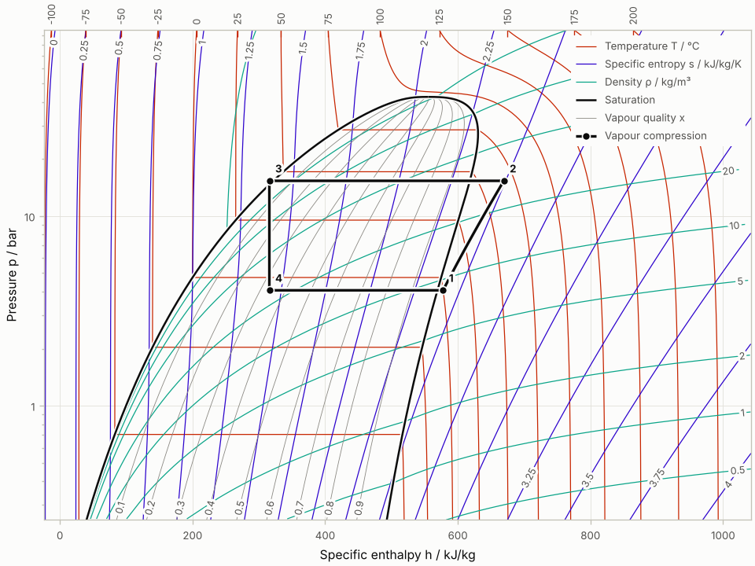

# CoolPlot

Property diagrams and psychrometric charts for engineering
thermodynamics, with [CoolProp](https://coolprop.org) as the source of
every property: log(p)-h, T-s, h-s, p-s, p-rho, T-rho and p-T diagrams
for pure fluids and refrigerant blends, cycles drawn on top of them, and
psychrometric charts for humid air.



```python
from coolplot import PropertyDiagram
from coolplot.thermo.cycles import simple_compression

diagram = PropertyDiagram("R290", "ph", units="engineering", tp_limits="ACHP")
diagram.set_default_lines(labels=True, rounding=True)
diagram.add_cycle(simple_compression("R290", T_evap_C=-5, T_cond_C=45, dT_sh_K=5))
diagram.save("R290_ph.png")
```

Where to go next:

* {doc}`getting_started`: install CoolPlot and draw a first chart.
* {doc}`gallery/index`: every kind of chart CoolPlot draws, each with the
  script that made it. A few of them:

```{eval-rst}
.. minigallery:: ../examples/two_stage_cycles.py ../examples/psychrometric_air_handling.py ../examples/steam_rankine_ts.py ../examples/co2_transcritical.py
```

* {doc}`tutorials/index`: a chart step by step, a heat pump from measured
  states, a psychrometric chart for an air handling unit, figures for a
  paper.
* {doc}`how_to/index`: units, isolines, labels, cycles, blends, PDF and
  print, themes, interactive applications, troubleshooting.
* {doc}`explanation/index`: what a change costs, how colours and labels
  are chosen, how the lines are computed, what is not supported.
* {doc}`reference/index`: every class and function, the tables of
  diagram types, units and presets, the file formats.
* {doc}`upgrade`: what changes between versions and how to keep the old
  behaviour.

```{toctree}
:maxdepth: 2
:hidden:

getting_started
gallery/index
tutorials/index
how_to/index
explanation/index
reference/index
upgrade
changelog
contributing/index
```
